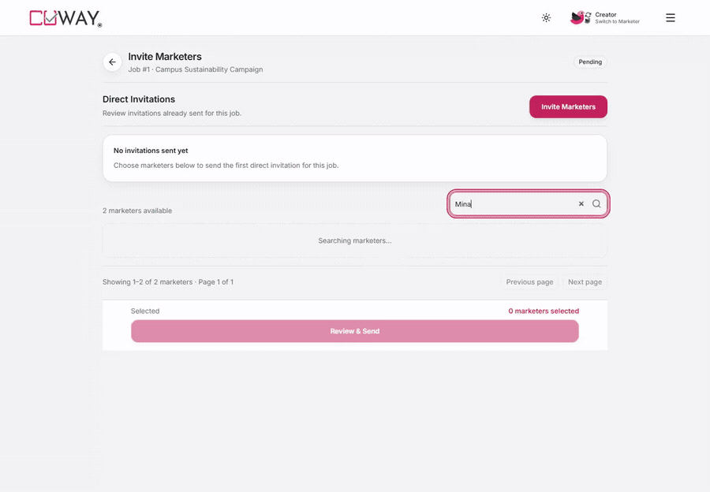
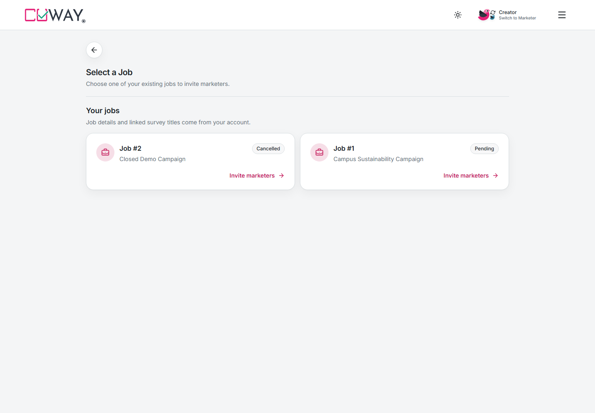
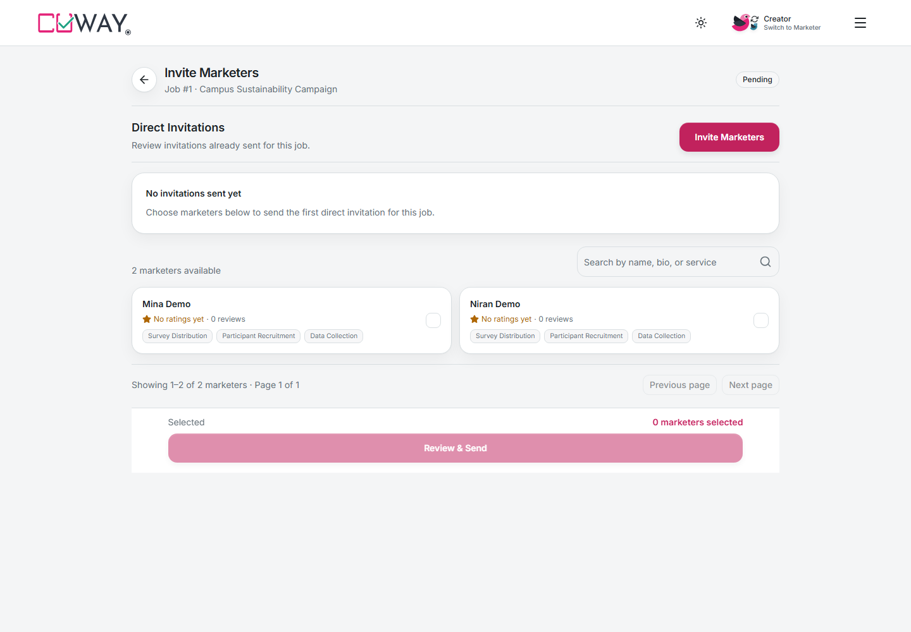
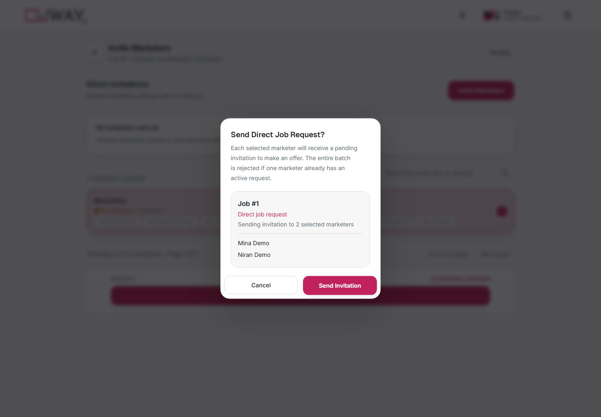
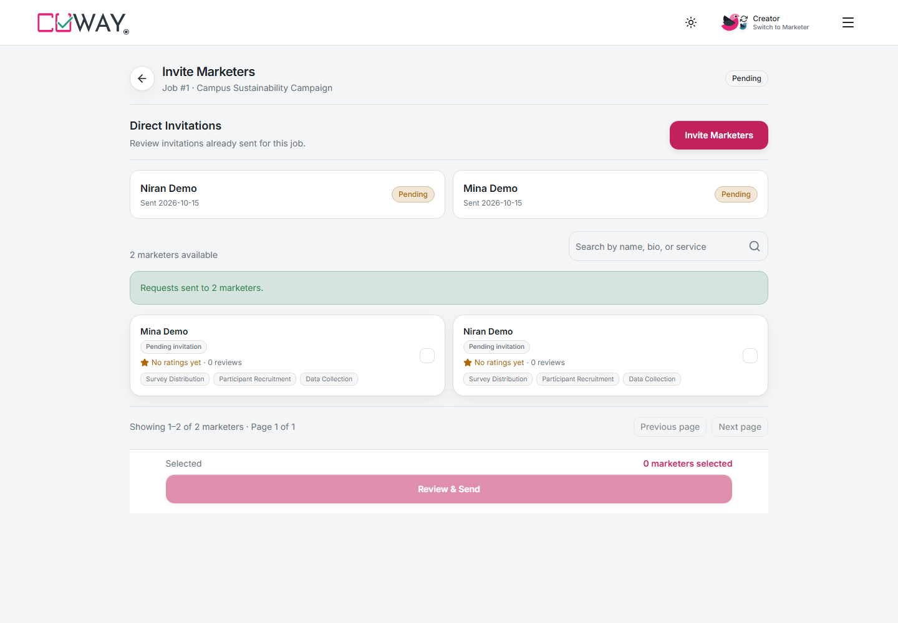
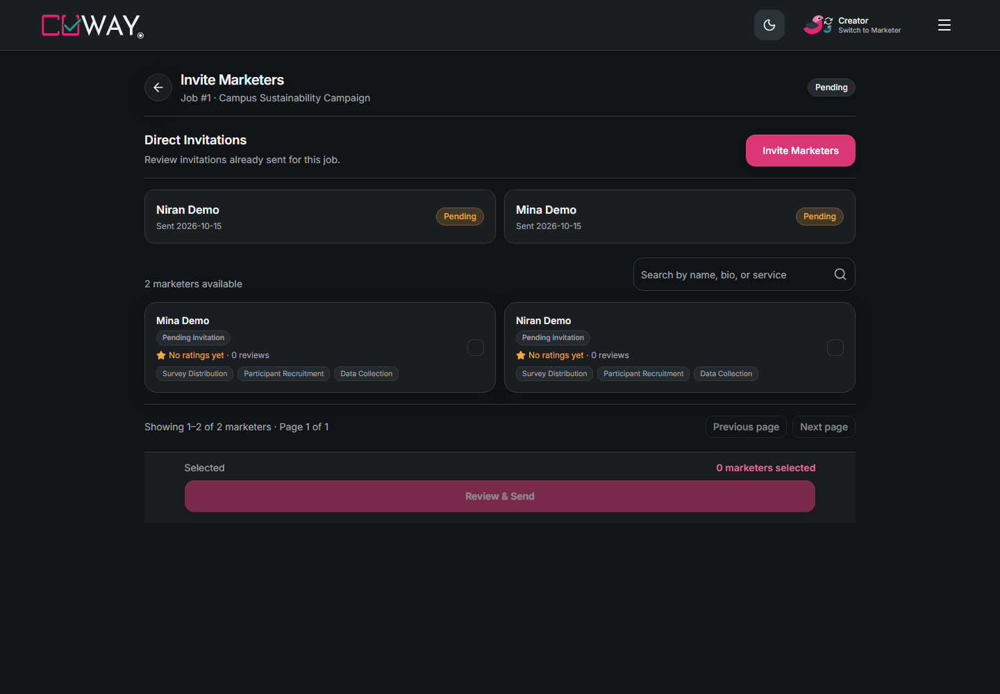
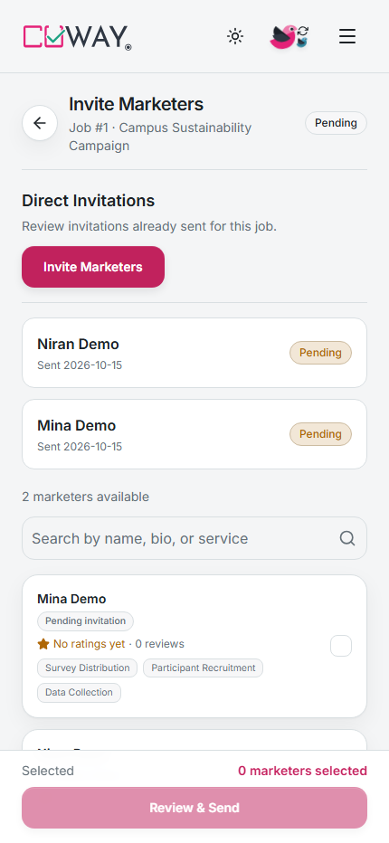
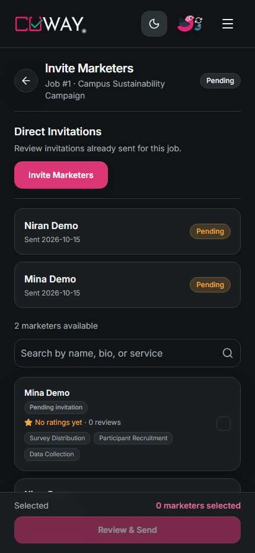
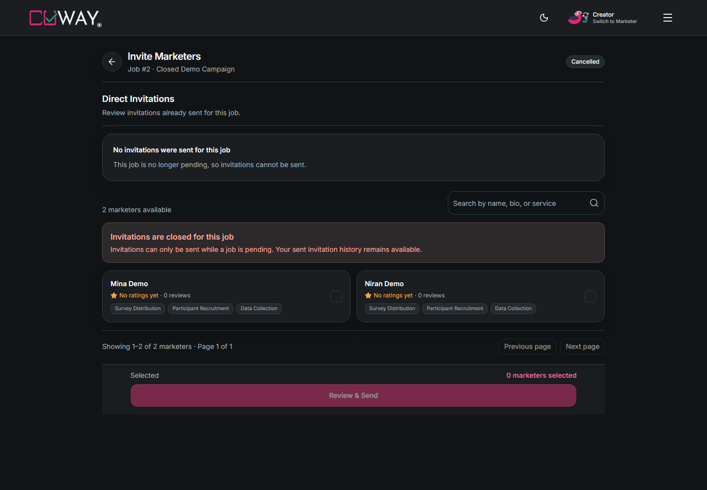
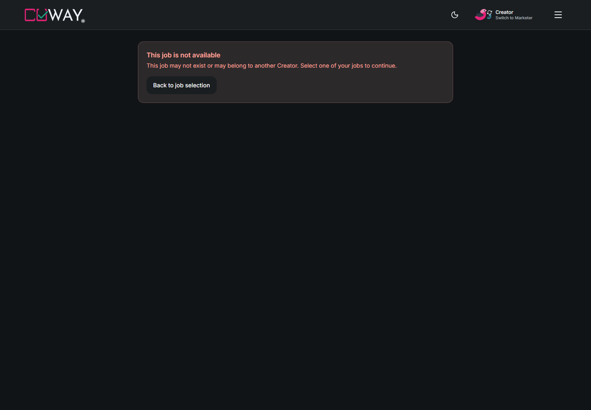

# US-019 Creator invitations walkthrough

This recording drives the production Next.js UI against the real Go API and an
owned disposable PostgreSQL database migrated through version 9. All accounts,
jobs, surveys, and invitations shown are synthetic review fixtures. The normal
development database was not used.

## Recording

[Watch or download the MP4 walkthrough](./creator-invitations.mp4).
Playwright uses `slowMo: 500`, deliberate reading pauses, and slower search
typing. The recording starts with an authenticated synthetic Creator; login
credentials and session tokens are never shown.

## What is demonstrated

1. Select an existing owned job; a foreign Creator's job is absent from the list.
2. See empty invitation history and a disabled send button before selection.
3. Search for a marketer, preserve selection after clearing search, and select
   two marketers.
4. Review recipient names, cancel without losing selection, then confirm.
5. Send two real invitations. Named Pending rows appear and those recipients
   become unavailable for duplicate selection.
6. Reload the page. Both invitations remain; an independent API read confirms
   two persisted Pending requests.
7. Switch to dark mode; inspect mobile light/dark screenshots.
8. Open a non-Pending job and see disabled invitation controls.
9. Open a foreign-owned job URL and see access denied before marketer selection.

## Screenshots

| Mobile light                        | Mobile dark                       |
| ----------------------------------- | --------------------------------- |
|  |  |

## Scope

Captured on 15 October 2026 from application commit `74b89b9`, with backend
`5e7c1e5`. The media commit only adds review evidence. API calls were not mocked;
the isolated fixture and servers were removed after capture. This demonstrates
the Creator send/history flow. The separate live Marketer inbox/offer pages
still require their own API integration.
